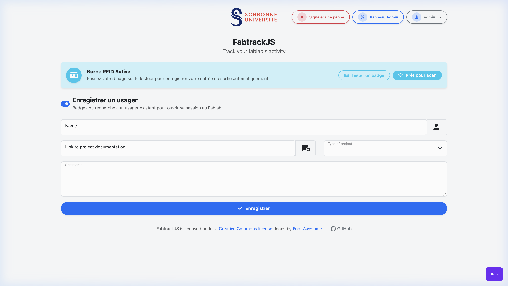
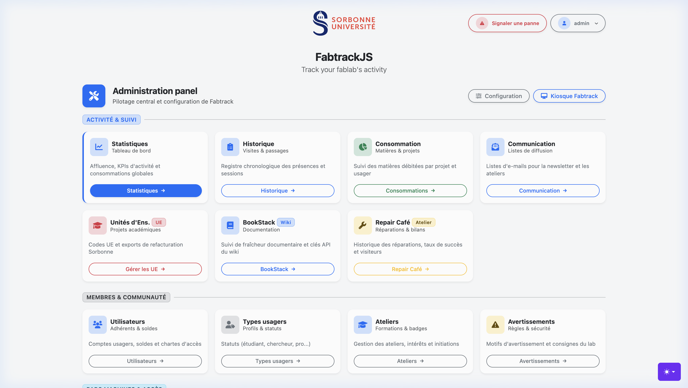
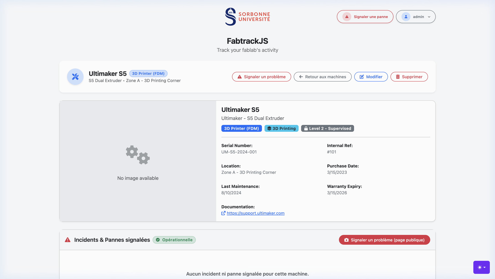
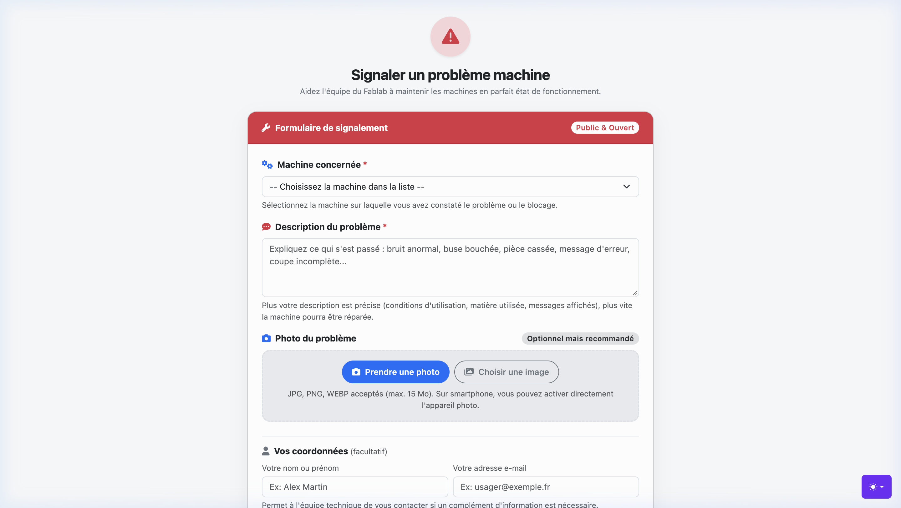
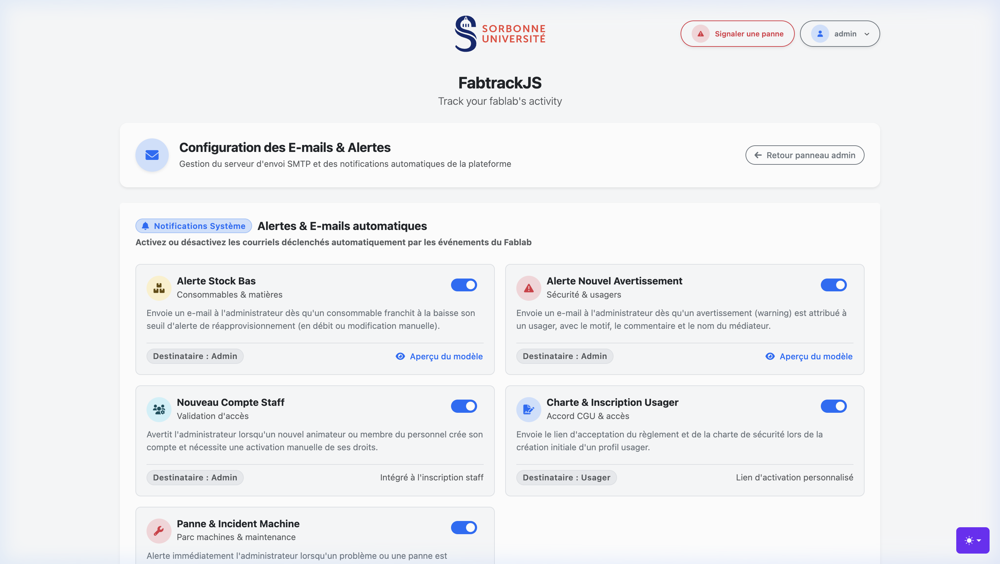

# FabtrackJS

FabtrackJS is a modern, open-source platform designed to track user activity, projects, equipment, and consumables inventory in fablabs and makerspaces. Built with Node.js, Express, MySQL, and Prisma ORM, it provides a clean, modular, and extensible architecture tailored for fablab managers, staff, and visitors.

---

## Table of Contents

- [Background](#background)
- [Key Features](#key-features)
- [Screenshots & Interface Preview](#screenshots--interface-preview)
- [Security Features](#security-features)
- [Plugins System](#plugins-system)
- [Prerequisites](#prerequisites)
- [Installation](#installation)
- [Configuration](#configuration)
- [Usage](#usage)
- [Automated Testing](#automated-testing)
- [Reverse Proxy & Production Deployment (Nginx)](#reverse-proxy--production-deployment-nginx)
- [Architecture & Tech Stack](#architecture--tech-stack)
- [Maintainers & License](#maintainers--license)

---

## Background

Initially developed in PHP/MySQL for the [Sorbonne University Fablab](https://fablab.sorbonne-universite.fr), FabtrackJS was rewritten from scratch in Node.js and Express to be modular, robust, and adaptable to any fablab, makerspace, or shared workshop.

I built the first two thirds of this version in 2023 with little to no AI-help. I then left the project on hold for 2 years and came back in 2026 to finish it with the help of the Antigravity IDE and Gemini 3.8 Flash.  

---

## Key Features

### 👥 User & Visitor Tracking
- Fast user check-in / check-out kiosk (`/fabtrack`) for daily visits.
- Detailed user profiles with usage statistics, activity history, and project affiliations.
- Disciplinary warnings system with categorization and admin email alerts.
- RFID reader integration for automated contactless badge scanning.

### 🛠️ Machine & Equipment Inventory
- Machine catalog with specifications, documentation links, locations, warranty dates, and maintenance tracking.
- Machine usage logs linked to users and projects.
- **Machine Incident & Breakdown Reporting** (`/report-issue`):
  - Completely public, mobile-first responsive reporting page accessible by anyone without login.
  - Smartphone camera button (`capture="environment"`) to directly photograph broken parts or error screens.
  - Pre-selection support via QR codes (`/report-issue/:machineId`).
  - Integrated directly into the machine's administrative history (`/admin/machines/view/:id#issues`).
  - Admin intervention workflow: mark as resolved with technical notes, reopen, or delete.
- **Equipment Loans & Restitution Tracking** (`/admin/equipment` & user profiles):
  - Loan duration configuration in days (default 7 days) with automated calculation of expected return dates.
  - Kiosk visual badge indicators (`fa-hand-holding-box`) alerting staff when a checked-in user holds unreturned equipment.
  - User profile loan section (`/users/edit/:id#loans`) with quick restitution confirmation modal.
  - Centralized admin supervision table displaying active loans, borrower names, checkout timestamps, overdue status highlights, and one-click return confirmation.

### 📦 Consumables & Stock Management
- Consumable inventory tracking with custom units (grams, meters, liters, units).
- Low stock threshold monitoring with automated email notifications to administrators.
- Project material consumption tracking and cost calculation.

### 🏢 Workspace & Category Organization
- Multi-workspace support (e.g. 3D printing lab, electronics lab, wood shop).
- Fast workspace switcher for multi-room fablabs.
- Equipment categorization by workspace.

### 📧 Automated Email & Notification Center (`/admin/emails`)
- Full SMTP configuration dashboard with live STARTTLS / direct SSL support.
- Live test email utility to verify SMTP settings.
- Independent notification toggles:
  - Consumable low-stock alerts.
  - User warning notifications.
  - Staff registration requests.
  - User safety charter & agreement activation links.
  - Machine breakdown & incident alerts.
  - Platform bug & feedback reports.
- Live visual previews of email templates in the admin interface.

### 🐛 Platform Bug & Feedback Reporting
- Direct reporting modal accessible from any page via the top navigation bar (`fa-bug`) and user dropdown menu.
- Categorized submissions (Bug / Defect, UI / Ergonomics, Feature Request).
- Automatic capture of the current page URL and user contact information.
- Sends instant structured HTML alert emails directly to the system administrator.

### 🌐 Internationalization (i18n) & Dynamic Translation
- Native multilingual support with dynamic locale detection.
- Fast language switcher in the bottom-right corner displaying flags and native names.
- **Dynamic CSV Export & Import Workflow** (`/admin/settings`):
  - Export all platform strings into a clean, UTF-8 BOM encoded spreadsheet (`translations.csv`) compatible with Microsoft Excel, LibreOffice, and Google Sheets.
  - Re-import updated translations directly through the web UI or CLI (`npm run i18n:import`).
  - **Automatic Language Creation**: adding a new column (e.g. `ES`, `DE`, `IT`) to the CSV automatically creates the corresponding language files and registers it throughout the entire platform.
  - Safe fallback system: untranslated phrases automatically fallback to French without breaking layouts.

### 🎨 Customizable Branding & Regional Settings (`/admin/settings`)
- Custom platform name and subtitle.
- Logo and favicon upload with strict raster validation (`PNG`, `JPG`, `WebP` for logos; `ICO`, `PNG` for favicons; default logo uses built-in SVG).
- **Configurable Date Display Format**:
  - `JJ/MM/AAAA` (French standard — default)
  - `AAAA-MM-JJ` (ISO 8601 standard)
  - `MM/JJ/AAAA` (US standard)
  - `JJ.MM.AAAA` (Swiss / German standard)
  - `Format long` (e.g., 13 septembre 2026)
  - Synchronized with French and English locales across all histories, profiles, and logs.
- Dynamic session expiration timeout.
- Configurable currency symbol (€, $, CHF, etc.).
- Configurable project type mappings for specialized plugins.

---

## Screenshots & Interface Preview

### 1. Visitor Check-in Kiosk (`/fabtrack`)
The main daily interface used by visitors and mediators to register entry, associate projects, and test RFID contactless badges. Features direct access to report issues and the admin panel in the top-right header.



---

### 2. Central Administration Hub (`/admin`)
The modular administrative dashboard organizing analytics, history, consumables, communications, academic billing, and extensible plugins (BookStack, Repair Café, Workshops).



---

### 3. Machine Details & Breakdown History (`/admin/machines/view/:id`)
Comprehensive machine tracking including technical specifications, warranty dates, location, documentation, and the **Incidents & Pannes signalées** resolution tracker.



---

### 4. Public Issue & Breakdown Reporting (`/report-issue`)
A completely public, mobile-first responsive reporting page allowing visitors or mediators to describe an issue, select a machine, and directly snap a photo with their smartphone camera (`capture="environment"`).



---

### 5. Automated Email & Notification Center (`/admin/emails`)
Centralized management of the SMTP delivery server with live testing and customizable automatic notifications (low stock, user warnings, staff accounts, machine breakdowns) with template previews.



---

## Security Features

FabtrackJS implements rigorous security practices:

- **Strict Schema-Based Input Validation**: All form submissions, URL params, query filters, and API endpoints are strictly validated using [Zod v4](https://zod.dev/) schemas (`schemas/`) with mass-assignment stripping (`req.body = result.data`). Form submissions redirect back with user-friendly French flash error toasts, while API calls receive standard `400 Bad Request` JSON payloads (`middleware/validate.js`).
- **HTTP Security Headers & Strict CSP**: Enforced with [Helmet](https://helmetjs.github.io/) using per-request cryptographic CSP nonces (`script-src` without `'unsafe-inline'`, `script-src-attr 'none'`), frame protection, and HSTS (when `ENABLE_HTTPS=true`).
- **CSRF Protection & Session Hardening**: Native session-synchronized CSRF protection (`middleware/csrf.js`), persistent MariaDB session store (`PrismaSessionStore`), dynamic staff session revocation, and fail-fast `SECRET` enforcement in production.
- **Password Security**: Strong bcrypt password hashing (`bcryptjs`, 10 salt rounds) with 8+ character minimum for new staff accounts.
- **Role-Based Access Control (RBAC)**: Distinct permissions for `admin`, `user` (mediator), and `staff` (kiosk terminal) via `middleware/requireRoles.js`.
- **Anti-Bot Honeypot & Rate Limiting**: Built-in rate limiting on auth/reset/public endpoints and honeypot field on staff registration.
- **Secure Password Reset**: Cryptographically random 256-bit tokens stored as SHA-256 hashes (64 hex chars) with short expiration and single-use atomic invalidation.
- **Secure File Uploads**: Magic-byte validation, file size limits, strict raster MIME/extension allowlists with [Multer](https://github.com/expressjs/multer), and random filenames outside executable contexts.
- **Operational Readiness & GDPR**: Public `GET /healthz` probe, structured NDJSON logs in production, masked RFID UIDs in `Log`, per-contributor GDPR JSON export (`GET /users/:id/export-rgpd`), and retention anonymization CLI (`npm run rgpd:anonymize`).

---

## Plugins System

FabtrackJS features an extensible plugin architecture built on an asynchronous hook manager (`core/HookManager.js`):

- **BookStack Wiki Plugin** (`plugins/bookstackPlugin.js`):
  - Integrates with the BookStack documentation platform.
  - Automatically pre-fills project documentation URLs.
  - Checks if documentation has been updated since the user's last visit.
  - Displays dynamic green/red status indicators.
  - Admin dashboard displaying API metrics and documentation compliance rates.
- **Repair Café Plugin** (`plugins/repairCafePlugin.js`):
  - Specialized workflow for community Repair Café events.
  - Dynamic form fields for repaired items and diagnostic notes.
  - Post-visit resolution modal tracking whether items were successfully repaired.
  - Statistics dashboard showing repair rates, visitor counts, and success metrics.
- **Workshop (Ateliers) Plugin** (`plugins/workshopPlugin.js`):
  - Tracks user registrations, interests, and completions of training workshops.
  - Automatically awards badges and unlocks machine access permissions upon workshop completion.
- **Academic / Teaching Units (UE) Plugin** (`plugins/teachingUnitsPlugin.js`):
  - Student project tracking and billing integration for university courses.
- **Sorbonne Projects Plugin** (`plugins/sorbonneProjectsPlugin.js`):
  - Institutional UFR / entity tracking and settlement exports for Sorbonne projects.
- **Borne RFID Plugin** (`plugins/rfidPlugin.js`):
  - Contactless badge-in/out integration for quick kiosk identification (UIDs masked in audit logs).

---

## Prerequisites

- [Node.js](https://nodejs.org/) (v20.x or v22.x)
- [npm](https://www.npmjs.com/) (v9 or higher)
- [MariaDB](https://mariadb.org/) 10.3+ / [MySQL](https://www.mysql.com/) 8.0+
- Git

---

## Installation

1. **Clone the repository**:
   ```bash
   git clone https://github.com/harry-finch/FabtrackJS.git
   cd FabtrackJS
   ```

2. **Install dependencies**:
   ```bash
   npm install
   ```
   *(A `postinstall` script automatically generates the Prisma Client without requiring manual intervention).*

3. **Configure environment variables**:
   Copy `.env.example` to `.env` and fill in your credentials:
   ```bash
   cp .env.example .env
   ```
   Key variables include `DATABASE_URL`, `DATABASE_URL_TEST`, `SECRET` (mandatory in production), `PORT=8080`, `HOSTURL="http://localhost:8080"`, `APP_TIMEZONE="Europe/Paris"`, `TRUST_PROXY=1`, and `SMTP_PORT=587` (never reuse `PORT` for SMTP).

4. **Deploy Database Schema & Migrations**:
   - **New installation** (Linux, macOS, NetBSD, FreeBSD):
     ```bash
     mariadb -u username -p database_name < prisma/schema.sql
     npm run db:migrate -- --baseline
     ```
   - **Upgrading an existing database** (100% pure JS, compatible with **NetBSD**):
     ```bash
     npm run db:migrate -- --status
     npm run db:migrate
     npx prisma generate
     ```

5. **Initialize & Configure FabtrackJS**:

   You can initialize your platform using either of two simplified methods:

   - **Method A: Interactive CLI Setup (Recommended)**:
     ```bash
     npm run setup
     ```
     Guides you step-by-step (with masked password input) to configure your administrator account, platform name, language, currency, and workspaces.

   - **Method B: Web Installation Wizard (`/setup`)**:
     ```bash
     npm start   # or npm run dev
     ```
     Open `http://localhost:8080` to be redirected to the guided **Web Setup Wizard** (`/setup`).

   - **Method C: Quick Demo / Development Seed**:
     ```bash
     npx prisma db seed
     ```

---

## Usage

### Development Mode (with automatic restart)
```bash
npm run dev
```

### Production Mode
```bash
npm start
```

Access the application in your browser at `http://localhost:8080`.

- **Health Probe**: `GET http://localhost:8080/healthz` (`200 { status: "ok", db: "ok" }` or `503`)
- **Public Machine Reporting**: `http://localhost:8080/report-issue`
- **GDPR Retention Anonymization**: `npm run rgpd:anonymize -- --months=36 --dry-run`
- **Production Upgrade Checklist**: see [docs/MISE_A_JOUR_PROD.md](docs/MISE_A_JOUR_PROD.md)

---

## Automated Testing

FabtrackJS includes a comprehensive automated test suite powered by [Jest](https://jestjs.io/) and [Supertest](https://github.com/ladjs/supertest), split into fast offline unit tests and database-isolated integration tests (`DATABASE_URL_TEST` ending in `_test`).

```bash
# Fast offline pure unit tests (no MariaDB required)
DATABASE_URL="" npm run test:unit

# Code style & static checks
npm run lint

# Full integration suite (requires DATABASE_URL_TEST ending in _test)
npm run test:integration

# Full suite (unit + integration)
npm test
```

### Test Coverage Highlights
- **User Creation & Duplicate Protection**: Account provisioning, default charter state, unique email enforcement (`tests/integration/userCreation.test.js`).
- **Balance & Transaction Logic**: User balance top-ups, debiting, and zero/negative balance handling (`tests/integration/balance.test.js`).
- **Safety Charter & Kiosk Access**: Access rules, badge scan enforcement, and charter agreement workflows (`tests/integration/charterAndKiosk.test.js`).
- **Equipment Borrowing & Restitution**: Loan creation with loan duration, expected return dates, user profile restitution, and admin supervision (`tests/integration/equipmentBorrow.test.js`).
- **Input Validation Middleware**: Zod form redirection with flash errors, API 400 responses, and NaN prevention (`tests/integration/validationMiddleware.test.js`).
- **Bug Reporting Flow**: Submission validation and administrative email dispatch (`tests/integration/bugReport.test.js`).
- **RFID Scanner Plugin & Hooks**: Badge check-in, check-out, and charter status enforcement (`tests/unit/rfidPlugin.test.js`).
- **Zod Schema Unit Tests**: Schema isolation, type coercion, and edge case input sanitization (`tests/unit/validation.test.js`).

---

## Reverse Proxy & Production Deployment (Nginx)

FabtrackJS is production-ready to run behind a reverse proxy such as Nginx. It includes:
- `trust proxy` enabled in Express (`app.set("trust proxy", 1)`) to properly detect HTTPS and client IP addresses.
- Isolated session cookie name (`fabtrack.sid`) to prevent collisions with other Express applications running on the same domain.
- Dynamic `<base href>` driven by `APP_BASE_PATH` in `.env` for subpath deployments.

### Strategy 1: Dedicated Subdomain (Recommended)
This is the standard and cleanest deployment approach:
```nginx
server {
    listen 443 ssl http2;
    server_name fabtrack.example.com;

    ssl_certificate /etc/ssl/certs/example.crt;
    ssl_certificate_key /etc/ssl/private/example.key;

    location / {
        proxy_pass http://127.0.0.1:8080;
        proxy_http_version 1.1;
        proxy_set_header Upgrade $http_upgrade;
        proxy_set_header Connection "upgrade";
        proxy_set_header Host $host;
        proxy_set_header X-Real-IP $remote_addr;
        proxy_set_header X-Forwarded-For $proxy_add_x_forwarded_for;
        proxy_set_header X-Forwarded-Proto $scheme;
    }
}
```

### Strategy 2: Dedicated HTTPS Port (e.g. `:8443`)
If you share a single hostname with other applications and cannot create a subdomain:
```nginx
server {
    listen 8443 ssl http2;
    server_name server.example.com;

    ssl_certificate /etc/ssl/certs/example.crt;
    ssl_certificate_key /etc/ssl/private/example.key;

    location / {
        proxy_pass http://127.0.0.1:8080;
        proxy_http_version 1.1;
        proxy_set_header Upgrade $http_upgrade;
        proxy_set_header Connection "upgrade";
        proxy_set_header Host $host;
        proxy_set_header X-Real-IP $remote_addr;
        proxy_set_header X-Forwarded-For $proxy_add_x_forwarded_for;
        proxy_set_header X-Forwarded-Proto $scheme;
    }
}
```

### Strategy 3: Subpath (e.g. `https://server.example.com/fabtrack/`)
1. In your `.env`, set:
   ```env
   APP_BASE_PATH="/fabtrack"
   ```
2. In your Nginx configuration:
   ```nginx
   location = /fabtrack {
       return 301 https://$host/fabtrack/;
   }

   location /fabtrack/ {
       proxy_pass http://127.0.0.1:8080/;

       proxy_http_version 1.1;
       proxy_set_header Upgrade $http_upgrade;
       proxy_set_header Connection "upgrade";
       proxy_set_header Host $host;
       proxy_set_header X-Real-IP $remote_addr;
       proxy_set_header X-Forwarded-For $proxy_add_x_forwarded_for;
       proxy_set_header X-Forwarded-Proto $scheme;
       proxy_set_header X-Forwarded-Prefix /fabtrack;

       proxy_set_header Accept-Encoding "";
       proxy_redirect ~^/(.*) /fabtrack/$1;
       proxy_cookie_path / /fabtrack/;

       sub_filter_types text/html text/css text/javascript application/javascript application/json;
       sub_filter_once off;
       sub_filter 'href="/' 'href="/fabtrack/';
       sub_filter 'src="/' 'src="/fabtrack/';
       sub_filter 'action="/' 'action="/fabtrack/';
   }
   ```

---

## Architecture & Tech Stack

| Layer | Technology |
|---|---|
| **Runtime** | Node.js (v20, v22) |
| **Framework** | Express.js (v4.22+) |
| **Database** | MariaDB 10.3+ / MySQL 8.0+ |
| **ORM & Migrations** | Prisma ORM (v7.10+) via `@prisma/adapter-mariadb` + NetBSD-safe SQL runner (`scripts/migrate.js`) |
| **Input Validation** | Zod (v4) + Strict Stripping Validation Middleware |
| **Testing & Lint** | Jest + Supertest (unit + isolated integration) + ESLint |
| **Template Engine** | EJS |
| **CSS & Components** | Bootstrap 5, FontAwesome 7 (served locally via `/vendor/fontawesome`) |
| **Authentication & Sessions** | Express Session + MariaDB `PrismaSessionStore` + bcryptjs |
| **Localization (i18n)** | node-i18n + Dynamic CSV Engine |
| **Date & Time** | Moment.js (per-request locale) + `APP_TIMEZONE` (`utilities/timezoneHelper.js`) |
| **File Uploads** | Multer (v2.4+) + Magic-byte raster verifier |
| **Email Delivery** | Nodemailer |
| **Security & Ops** | Helmet strict nonce CSP, native CSRF, SSRF guard, `/healthz`, NDJSON logs, GDPR tools, 0 prod CVEs |

---

## Maintainers & License

- Original Author: Stéphane Muller
- Current Repository: [harry-finch/FabtrackJS](https://github.com/harry-finch/FabtrackJS)
- Licensed under the [MIT License](LICENSE). Icons by [Font Awesome Free](https://fontawesome.com/) (CC BY 4.0).
